  🌐 <a href="README.md">English</a> · <a href="README.pt-BR.md">Português</a> · <b>Español</b>

  

<h3 align="center">Convierto problemas complejos en soluciones simples que funcionan.</h3>

  Especialista en Transformación Digital · Datos, Automatización de Procesos e Integración de Sistemas 
  Más de 15 años conectando datos, automatización e integración de sistemas con operaciones industriales críticas.

  
  
  
  

---

## 👋 Sobre mí

Soy ingeniero electricista con **más de 15 años** en operaciones industriales críticas. Mi camino va de equipos de campo, subestaciones de 230 kV y distribución eléctrica de mina a Power BI, Power Automate, pipelines de integración y agentes de IA; por eso entiendo tanto el equipo como los datos que genera.

Hoy soy **Especialista en Soporte Tecnológico en Orica**, trabajando con equipos internacionales de producto e ingeniería en la transformación digital de operaciones mineras.

Lo que me diferencia es la **creatividad** y la **resolución de problemas complejos**. Puedo tomar una necesidad todavía difusa, convertirla en un producto que funciona y liderar el proyecto que lo pone en manos de las personas.

<table>
  <tr>
    <td align="center" valign="top" width="25%"><h3>3 min → 40 s</h3>tiempo de análisis tras rediseñar el flujo para que funcione offline</td>
    <td align="center" valign="top" width="25%"><h3>−15% · −23%</h3>costo de combustible y tiempo entre actividades de campo, con optimización de rutas</td>
    <td align="center" valign="top" width="25%"><h3>35 personas</h3>mayor equipo de campo liderado, en operaciones de telecomunicaciones</td>
    <td align="center" valign="top" width="25%"><h3>230 kV</h3>subestaciones y redes de media y baja tensión mantenidas y operadas</td>
  </tr>
</table>

## 💼 Experiencia

#### Especialista en Soporte Tecnológico · Orica
jun 2025 – actualidad · Belo Horizonte, Brasil

- Eliminé la actualización manual de datos de una plataforma de software minero con un pipeline de integración basado en GitHub que sincroniza los datos automáticamente.
- Rediseñé el flujo de datos y reportes de una plataforma de monitoreo ambiental, para que las comunidades vecinas puedan verificar por sí mismas si una voladura causó vibraciones por encima de los límites normativos.
- Reduje el tiempo de análisis de fragmentación de más de 3 minutos a 40 segundos al rediseñar el flujo para procesar los datos offline, lo que permite decisiones inmediatas en terreno y en despacho, con o sin internet.
- Trabajé con equipos internacionales de producto e ingeniería para diseñar, ajustar e implementar soluciones en varias regiones dentro de la hoja de ruta global de transformación digital.
- Reduje el riesgo de pérdida y mal uso de equipos implementando controles completos de trazabilidad para las tablets de campo.

#### Ingeniero Electricista Sénior · GroundProbe
mar 2020 – jun 2025 · Belo Horizonte, Brasil

- Mejoré la confiabilidad de los equipos desarrollando software propio para automatizar equipos y procesos de monitoreo.
- Fui responsable del seguimiento de KPIs, la gestión de activos y las iniciativas de mejora continua en toda la cartera de clientes.
- Reduje las paradas de equipos de los clientes diagnosticando problemas técnicos complejos con soporte remoto rápido e intervenciones en terreno en las minas.
- Lideré la instalación, la puesta en marcha y la capacitación práctica en equipos de monitoreo de alta tecnología.

#### Líder Técnico (Técnico Electricista/Electrónico) · Vale
ene 2018 – mar 2020 · Parauapebas, Brasil

- Lideré un equipo multidisciplinario en la operación del mayor sistema interno de distribución eléctrica de la mina de hierro de Carajás: instalación, mantenimiento y capacitación en redes de baja y media tensión, arrancadores suaves, reconectadores y SCADA.
- Aumenté la seguridad y la confiabilidad de la planta automatizando procesos críticos y resolviendo fallas técnicas complejas.

<b>Experiencia anterior (2011 – 2018)</b>

 

**Técnico Electrónico · Vestatech** · jul 2017 – ene 2018 
Mantenimiento preventivo y correctivo certificado y calibración de equipos hospitalarios y odontológicos, incluidos sistemas de imagen y monitores de signos vitales.

**Líder de Equipo (Técnico Electrotécnico) · Nortkar** · sep 2015 – dic 2016 
Lideré un equipo de campo de 5 personas en el mantenimiento de redes de distribución; mantuve redes subterráneas de 34,5 kV y subestaciones de 230 kV (celdas aisladas en gas SF6, puesta a tierra, protección contra rayos y generación de respaldo).

**Supervisor Regional · Oi** · jul 2011 – sep 2015 
Reduje un 15% el costo de combustible y un 23% el tiempo entre actividades de campo con un programa de optimización de rutas y gestión de actividades para un equipo de 35 personas; lideré el despliegue regional de banda ancha y mantuve operativo el backbone de fibra óptica crítico de la mina de Carajás.

## 🎓 Formación

- 🧭 **MBA en Gestión de Proyectos: Liderazgo, Estrategia y Negocios** · PUC Minas · en curso, finaliza abr 2027
- 📊 **Posgrado en Ciencia de Datos** · Universidade Anhembi Morumbi · 2024 – 2025
- ⚡ **Ingeniería Eléctrica y Electrónica** (grado) · UNINTER · 2017 – 2023
- 🏭 **Técnico en Automatización Industrial** · SENAI · 2016 – 2017
- 🔌 **Técnico en Electrotecnia** · CEETEPS · 2008 – 2009

**Certificaciones:** Gestión de la Seguridad de la Información (ISO 27001 y 27002) · Ingeniería, Preparación y Visualización de Datos · Big Data Analytics · Gestión del Conocimiento e Inteligencia Competitiva · Scrum · Gestión de Riesgos (Axelos)

**Idiomas:** portugués (nativo) · inglés (avanzado, B2) · español (avanzado, B2)

## 💡 Fortalezas

<table>
  <tr>
    <td width="33%" valign="top">
      <b>🧩 Resolución de problemas complejos</b> 
      Desarmo problemas enredados, que involucran varios sistemas, y encuentro la solución más simple que funciona en el mundo real.
    </td>
    <td width="33%" valign="top">
      <b>🎨 Creatividad</b> 
      Nuevos ángulos para problemas viejos: un juego, una experiencia en VR o una automatización donde otros escribirían un manual.
    </td>
    <td width="33%" valign="top">
      <b>📊 Datos y BI</b> 
      Power BI (modelado de datos, DAX, dashboards y reportes), ETL, SQL, Python, big data y agentes con LLMs.
    </td>
  </tr>
  <tr>
    <td width="33%" valign="top">
      <b>🏢 Microsoft 365 y low-code</b> 
      Flujos de Power Automate integrados con SharePoint, Teams y todo Microsoft 365, Power Apps y Azure.
    </td>
    <td width="33%" valign="top">
      <b>⚡ Automatización e integración</b> 
      APIs REST, pipelines de datos, Node-RED, MQTT, Modbus, OPC UA, SCADA, PLCs, GPS y LiDAR.
    </td>
    <td width="33%" valign="top">
      <b>🧭 Liderazgo y gobernanza</b> 
      Equipos de campo de hasta 35 personas, mapeo de procesos, Scrum, gestión de riesgos y seguridad de la información (ISO 27001/27002).
    </td>
  </tr>
</table>

## 🚀 Proyectos destacados

### Industria y operaciones

<table>
  <tr>
    <td width="50%" valign="top">
      <h4>🥽 Experiencia inmersiva de la cadena de valor</h4>
      
🔒 proyecto interno · VR / realidad mixta para eventos y capacitación

      
El visitante está en una plataforma flotante sobre una mina a cielo abierto, elige una etapa de la cadena de valor y vuela hasta allí para ver, en el campo, cómo actúa cada solución.

      
▸ motor de temporización del proceso cubierto por pruebas ▸ vuelo entre estaciones pensado para el confort ▸ corre en el navegador del visor, sin instalar apps

      
<code>WebXR</code> <code>Babylon.js</code> <code>TypeScript</code>

    </td>
    <td width="50%" valign="top">
      <h4>📸 Monitoreo de borde para estaciones de medición</h4>
      
🔒 proyecto interno · cintas transportadoras y equipos de carguío

      
Dashboard local para estaciones de medición con cámaras, con alarma sonora en el instante en que aparece material fuera de especificación.

      
▸ Node.js puro: cero dependencias y autorrecuperación ▸ instalador de un clic con runtime incluido, topología borde + central ▸ publica en Webhook, MQTT, Modbus TCP y OPC UA; cada integración está aislada para que nunca derribe la alarma

      
<code>Node.js</code> <code>MQTT</code> <code>Modbus TCP</code> <code>OPC UA</code>

    </td>
  </tr>
  <tr>
    <td width="50%" valign="top">
      <h4>📈 Dashboard de cumplimiento ambiental</h4>
      
🔒 proyecto interno · vibración del terreno y sobrepresión acústica

      
Cruza eventos de la operación con las lecturas de estaciones de monitoreo en campo y destaca al instante cualquier valor por encima del límite normativo elegido.

      
▸ métricas acústicas (sobrepresión y dBA) calculadas a partir de los datos crudos ▸ biblioteca de límites editable, basada en normas brasileñas, alemanas y estadounidenses ▸ ventana de asociación configurable, 4 niveles de acceso, contraseñas con hash PBKDF2

      
<code>Serverless</code> <code>Base clave-valor</code> <code>APIs REST</code>

    </td>
    <td width="50%" valign="top">
      <h4>🛡️ Quiosco para tablets robustas de campo</h4>
      
🔒 proyecto interno · Windows · uso en campo

      
Restringe tablets robustas con Windows a las apps que el operador necesita, manteniendo el soporte simple para el equipo de TI.

      
▸ administración con contraseña, bloqueo de USB en tiempo real y filtro de internet ▸ cerca de 35 perfiles LTE/APN de operadoras de Sudamérica ▸ teclas físicas mapeadas por fabricante, teclado virtual, EN · PT · ES

      
<code>Electron</code> <code>Node.js</code> <code>PowerShell</code>

    </td>
  </tr>
</table>

### Productos y laboratorio personal

<table>
  <tr>
    <td width="50%" valign="top">
      <h4>🎬 Línea de videos con IA para marketing de afiliados</h4>
      
🔒 privado · 7 flujos de automatización

      
Del descubrimiento del producto a la publicación: un agente de IA selecciona las ofertas, otro escribe el guion y un revisor lo aprueba; la IA anima las fotos reales del producto, el video se monta y yo lo apruebo desde el celular.

      
▸ aprobación humana a través de un chat bot ▸ publica en las principales plataformas de videos cortos ▸ cada semana aprende del CTR y la conversión y ajusta los próximos guiones

      
<code>n8n</code> <code>Agentes de IA</code> <code>Chat bots</code> <code>Video generativo</code>

    </td>
    <td width="50%" valign="top">
      <h4>🏍️ Liberum</h4>
      
🔒 privado · plataforma de viajes en moto

      
Plataforma para quienes viajan en moto: crear e importar rutas, llevar un diario de cada viaje y explorar rutas reales calificadas por la comunidad.

      
▸ Postgres con PostGIS y seguridad por fila (RLS) ▸ mapas vectoriales interactivos ▸ infraestructura del MVP 100% en planes gratuitos

      
<code>Next.js</code> <code>TypeScript</code> <code>Tailwind</code> <code>PostGIS</code>

    </td>
  </tr>
  <tr>
    <td width="50%" valign="top">
      <h4>🗝️ Treasure Hunter</h4>
      
🔒 privado · juego móvil basado en ubicación

      
Búsqueda del tesoro urbana en el celular: resuelve el acertijo, camina hasta el lugar, apunta el celular en la dirección y el ángulo correctos, escanea el sello en el sitio y el cofre se abre en la cámara.

      
▸ GPS, brújula e inclinación del dispositivo como condiciones del juego ▸ mapas con niebla para centros comerciales y eventos, cupones de socios ▸ el servidor decide cada resultado y el celular solo lo predice, lo que impide las trampas

      
<code>PWA</code> <code>Node.js</code> <code>Geolocalización</code>

    </td>
    <td width="50%" valign="top">
      <h4>💰 Sistema de gestión financiera personal</h4>
      
🔒 privado · finanzas del hogar en piloto automático

      
Cada compra va a un chat bot que la clasifica con botones y la registra; presupuesto, tarjetas de crédito, metas y proyección de los próximos 12 meses se calculan solos.

      
▸ informe semanal y recordatorios de cuentas ▸ app instalable con inicio de sesión por chat ▸ funciona sin IP pública y avisa cuando algo falla

      
<code>n8n</code> <code>Docker</code> <code>PWA</code> <code>Serverless</code>

    </td>
  </tr>
</table>

### Código abierto

- 🎓 **[Curso de automatización con PLC](https://github.com/acarolli/curso-automacao-winsps-s7-e-factory-io)** (en portugués): programación de PLC con plantas industriales simuladas, en ejercicios progresivos desde el arranque directo de un motor hasta un paletizador y un almacén automático.

## 🧰 Stack

**Datos y BI** 

**Microsoft 365 y low-code** 

**Automatización e integración** 

**Web, móvil y XR** 

**Plataforma y DevOps** 

## 🛠️ Cómo trabajo

- **Empiezo por el problema real.** La tecnología viene después de entender quién la usa, dónde y con qué conexión.
- **Creatividad con método.** Exploro muchas opciones y elijo la más simple que resuelve.
- **Resiliente por defecto.** Pocas dependencias, servicios que se recuperan solos e integraciones aisladas: si una falla, el resto sigue.
- **Seguro desde el diseño.** Niveles de acceso, contraseñas con hash, secretos fuera del repositorio, dispositivos bloqueados.
- **Bajo costo.** Planes gratuitos y borde primero; servidores dedicados solo cuando se justifican.
- **Listo para entregar.** Instalador, documentación, capacitación y pruebas son parte del producto.

## 📌 Ahora

- 🧭 Cursando el MBA en Gestión de Proyectos: Liderazgo, Estrategia y Negocios en la PUC Minas.
- 🥽 Construyendo una experiencia inmersiva en VR que explica una cadena de valor industrial en eventos.
- 🤖 Llevando agentes de IA al flujo de ingeniería, de la especificación a las pruebas.

## 📫 Contacto

⚡ → 📊 → 🚀 de la señal al dato, del dato a la decisión

