  🌐 <b>English</b> · <a href="README.pt-BR.md">Português</a> · <a href="README.es.md">Español</a>

  

<h3 align="center">I turn complex problems into simple solutions that work.</h3>

  Digital Transformation Specialist · Data, Process Automation &amp; Systems Integration 
  15+ years connecting data, automation and systems integration to critical industrial operations.

  
  
  
  

---

## 👋 About me

I'm an electrical engineer with **15+ years** in critical industrial operations. My path goes from field crews, 230 kV substations and mine power distribution to Power BI, Power Automate, integration pipelines and AI agents, so I understand both the equipment and the data it produces.

Today I'm a **Technology Support Specialist at Orica**, working with international product and engineering teams on digital transformation for mining operations.

What sets me apart is **creativity** and **complex problem solving**. I can take a vague pain point, turn it into a working product, and lead the project that puts it in people's hands.

<table>
  <tr>
    <td align="center" valign="top" width="25%"><h3>3 min → 40 s</h3>analysis turnaround after redesigning the workflow to run offline</td>
    <td align="center" valign="top" width="25%"><h3>−15% · −23%</h3>fuel costs and time between field jobs, with route optimization</td>
    <td align="center" valign="top" width="25%"><h3>35 people</h3>largest field team led, in telecom operations</td>
    <td align="center" valign="top" width="25%"><h3>230 kV</h3>substations and MV/LV networks maintained and operated</td>
  </tr>
</table>

## 💼 Experience

#### Technology Support Specialist · Orica
Jun 2025 – present · Belo Horizonte, Brazil

- Eliminated manual data updates for a mining software platform by building a GitHub-based integration pipeline for automated data synchronization.
- Re-engineered the data and reporting workflow of an environmental monitoring platform, so surrounding communities can independently verify whether a blast caused vibration above regulatory limits.
- Cut fragmentation-analysis turnaround from over 3 minutes to 40 seconds by redesigning the workflow to process data offline, enabling immediate on-site and dispatch decisions regardless of connectivity.
- Partnered with international product and engineering teams to design, refine and deploy solutions across regions for the global digital-transformation roadmap.
- Reduced equipment loss and misuse risk by implementing full asset-traceability controls for field tablets.

#### Senior Electrical Engineer · GroundProbe
Mar 2020 – Jun 2025 · Belo Horizonte, Brazil

- Improved equipment reliability by developing custom software to automate monitoring equipment and processes.
- Owned KPI tracking, asset management and continuous-improvement initiatives across the client portfolio.
- Minimized client downtime by diagnosing complex technical issues through rapid remote support and on-site intervention at mine sites.
- Led on-site installation, commissioning and hands-on training on high-technology monitoring equipment.

#### Technical Lead (Electrical/Electronics Technician) · Vale
Jan 2018 – Mar 2020 · Parauapebas, Brazil

- Led a multidisciplinary team operating the largest internal electrical distribution system at the Carajás iron-ore mine: installation, maintenance and training on LV/MV networks, soft-starters, reclosers and SCADA.
- Increased plant safety and reliability by automating critical processes and resolving complex technical failures.

<b>Earlier experience (2011 – 2018)</b>

 

**Electronics Technician · Vestatech** · Jul 2017 – Jan 2018 
Certified preventive and corrective maintenance and calibration of hospital and dental equipment, including imaging systems and vital-signs monitors.

**Team Lead (Electrotechnical Technician) · Nortkar** · Sep 2015 – Dec 2016 
Led a 5-person field team maintaining distribution networks; maintained 34.5 kV underground networks and 230 kV substations (SF6 gas-insulated switchgear, grounding, lightning protection and backup generation).

**Regional Supervisor · Oi** · Jul 2011 – Sep 2015 
Cut fuel costs by 15% and time between field activities by 23% with a route-optimization and activity-management program for a 35-person team; led the regional broadband rollout and kept the critical fiber-optic backbone of the Carajás mine running.

## 🎓 Education

- 🧭 **MBA, Project Management: Leadership, Strategy &amp; Business** · PUC Minas · in progress, expected Apr 2027
- 📊 **Postgraduate Diploma, Data Science** · Universidade Anhembi Morumbi · 2024 – 2025
- ⚡ **Bachelor's Degree, Electrical and Electronics Engineering** · UNINTER · 2017 – 2023
- 🏭 **Technical Degree, Industrial Automation** · SENAI · 2016 – 2017
- 🔌 **Technical Degree, Electrotechnics** · CEETEPS · 2008 – 2009

**Certifications:** Information Security Management (ISO 27001 &amp; 27002) · Data Engineering, Preparation &amp; Visualization · Big Data Analytics · Knowledge Management &amp; Competitive Intelligence · Scrum · Risk Management (Axelos)

**Languages:** Portuguese (native) · English (advanced, B2) · Spanish (advanced, B2)

## 💡 Core strengths

<table>
  <tr>
    <td width="33%" valign="top">
      <b>🧩 Complex problem solving</b> 
      I break down messy, multi-system problems and find the simplest solution that holds up in the real world.
    </td>
    <td width="33%" valign="top">
      <b>🎨 Creativity</b> 
      New angles on old problems: a game, a VR experience or an automation where others would write a manual.
    </td>
    <td width="33%" valign="top">
      <b>📊 Data &amp; BI</b> 
      Power BI (data modeling, DAX, dashboards and reports), ETL, SQL, Python, big data analytics and LLM agents.
    </td>
  </tr>
  <tr>
    <td width="33%" valign="top">
      <b>🏢 Microsoft 365 &amp; low-code</b> 
      Power Automate flows integrated with SharePoint, Teams and the wider Microsoft 365 suite, Power Apps and Azure.
    </td>
    <td width="33%" valign="top">
      <b>⚡ Automation &amp; integration</b> 
      REST APIs, data pipelines, Node-RED, MQTT, Modbus, OPC UA, SCADA, PLCs, GPS and LiDAR.
    </td>
    <td width="33%" valign="top">
      <b>🧭 Leadership &amp; governance</b> 
      Field teams of up to 35 people, process mapping, Scrum, risk management and information security (ISO 27001/27002).
    </td>
  </tr>
</table>

## 🚀 Featured work

### Industry &amp; operations

<table>
  <tr>
    <td width="50%" valign="top">
      <h4>🥽 Immersive value-chain experience</h4>
      
🔒 internal · VR / mixed reality for events and training

      
Visitors stand on a floating platform over an open-pit mine, pick a stage of the value chain and fly there to see, in the field, how each solution works.

      
▸ process timing engine covered by unit tests ▸ comfort-first flight between stations ▸ runs in the headset's browser, no app install

      
<code>WebXR</code> <code>Babylon.js</code> <code>TypeScript</code>

    </td>
    <td width="50%" valign="top">
      <h4>📸 Edge monitoring for measurement stations</h4>
      
🔒 internal · conveyors and loading equipment

      
Local dashboard for camera-based measurement stations, with an audible alarm the moment out-of-spec material shows up.

      
▸ plain Node.js: zero dependencies, self-healing ▸ one-click installer with embedded runtime, edge + central topology ▸ publishes to Webhook, MQTT, Modbus TCP and OPC UA; each integration is isolated so it can never take the alarm down

      
<code>Node.js</code> <code>MQTT</code> <code>Modbus TCP</code> <code>OPC UA</code>

    </td>
  </tr>
  <tr>
    <td width="50%" valign="top">
      <h4>📈 Environmental compliance dashboard</h4>
      
🔒 internal · ground vibration and air overpressure

      
Matches operational events with readings from field monitoring stations and instantly flags any value above the selected regulatory limit.

      
▸ acoustic metrics (overpressure and dBA) computed from raw data ▸ editable limit library based on Brazilian, German and US standards ▸ configurable matching window, 4 access levels, PBKDF2 password hashing

      
<code>Serverless</code> <code>Key-value store</code> <code>REST APIs</code>

    </td>
    <td width="50%" valign="top">
      <h4>🛡️ Kiosk shell for rugged field tablets</h4>
      
🔒 internal · Windows · used in the field

      
Locks rugged Windows tablets down to the apps operators need, while keeping support simple for the IT team.

      
▸ password-protected admin, real-time USB lock and web filter ▸ about 35 LTE/APN carrier profiles across South America ▸ hardware-key mapping per manufacturer, on-screen keyboard, EN · PT · ES

      
<code>Electron</code> <code>Node.js</code> <code>PowerShell</code>

    </td>
  </tr>
</table>

### Products &amp; personal lab

<table>
  <tr>
    <td width="50%" valign="top">
      <h4>🎬 AI video pipeline for affiliate marketing</h4>
      
🔒 private · 7 automation workflows

      
From product discovery to publishing: one AI agent curates offers, another writes the script and a reviewer approves it; AI animates the real product photos, the video is assembled and I approve it from my phone.

      
▸ human-in-the-loop approval through a chat bot ▸ publishes to the main short-video platforms ▸ learns every week from CTR and conversion and tunes the next scripts

      
<code>n8n</code> <code>AI agents</code> <code>Chat bots</code> <code>Generative video</code>

    </td>
    <td width="50%" valign="top">
      <h4>🏍️ Liberum</h4>
      
🔒 private · motorcycle travel platform

      
A platform for riders who travel: create and import routes, keep a journal of each trip and explore real routes rated by the community.

      
▸ Postgres with PostGIS and row-level security ▸ interactive vector maps ▸ MVP infrastructure running 100% on free tiers

      
<code>Next.js</code> <code>TypeScript</code> <code>Tailwind</code> <code>PostGIS</code>

    </td>
  </tr>
  <tr>
    <td width="50%" valign="top">
      <h4>🗝️ Treasure Hunter</h4>
      
🔒 private · location-based mobile game

      
A city treasure hunt on the phone: solve the riddle, walk to the place, point the phone in the right direction and angle, scan the seal on site and the chest opens in the camera.

      
▸ GPS, compass and device tilt as game conditions ▸ fog-of-war maps for malls and events, partner coupons ▸ the server decides every result and the phone only predicts it, which stops cheating

      
<code>PWA</code> <code>Node.js</code> <code>Geolocation</code>

    </td>
    <td width="50%" valign="top">
      <h4>💰 Personal finance management system</h4>
      
🔒 private · household finances on autopilot

      
Each purchase goes to a chat bot that classifies it with buttons and stores it; budget, card bills, goals and a 12-month projection are calculated automatically.

      
▸ weekly report and bill reminders ▸ installable app with chat-based login ▸ works without a public IP and alerts when something breaks

      
<code>n8n</code> <code>Docker</code> <code>PWA</code> <code>Serverless</code>

    </td>
  </tr>
</table>

### Open source

- 🎓 **[PLC automation course](https://github.com/acarolli/curso-automacao-winsps-s7-e-factory-io)** (in Portuguese): PLC programming with simulated industrial plants, in progressive exercises from a direct-on-line motor start to a palletizer and an automated storage and retrieval system.

## 🧰 Tech stack

**Data &amp; BI** 

**Microsoft 365 &amp; low-code** 

**Automation &amp; integration** 

**Web, mobile &amp; XR** 

**Platform &amp; DevOps** 

## 🛠️ How I work

- **Start from the real problem.** Technology comes after understanding who uses it, where, and with what connection.
- **Creativity with method.** Explore many options, then pick the simplest one that solves the problem.
- **Resilient by default.** Few dependencies, self-healing services and isolated integrations: if one fails, the rest keeps running.
- **Secure by design.** Access levels, hashed passwords, secrets out of the repository, locked-down devices.
- **Low cost.** Free tiers and the edge first; dedicated servers only when they pay off.
- **Ready to hand over.** Installers, documentation, training and tests are part of the product.

## 📌 Now

- 🧭 MBA in Project Management: Leadership, Strategy &amp; Business at PUC Minas.
- 🥽 Building an immersive VR experience that explains an industrial value chain at events.
- 🤖 Bringing AI agents into the engineering workflow, from spec to tests.

## 📫 Contact

⚡ → 📊 → 🚀 from signal to data to decision

