  🌐 <a href="README.md">English</a> · <b>Português</b> · <a href="README.es.md">Español</a>

  

<h3 align="center">Transformo problemas complexos em soluções simples que funcionam.</h3>

  Especialista em Transformação Digital · Dados, Automação de Processos e Integração de Sistemas 
  Mais de 15 anos conectando dados, automação e integração de sistemas a operações industriais críticas.

  
  
  
  

---

## 👋 Sobre mim

Sou engenheiro eletricista com **mais de 15 anos** em operações industriais críticas. Minha trajetória vai de equipes de campo, subestações de 230 kV e distribuição elétrica de mina até Power BI, Power Automate, pipelines de integração e agentes de IA; por isso entendo tanto o equipamento quanto os dados que ele gera.

Hoje sou **Especialista de Suporte em Tecnologia na Orica**, trabalhando com times internacionais de produto e engenharia na transformação digital de operações de mineração.

O que me diferencia é **criatividade** e **solução de problemas complexos**. Consigo pegar uma dor ainda vaga, transformar em um produto que funciona e liderar o projeto que o coloca nas mãos das pessoas.

<table>
  <tr>
    <td align="center" valign="top" width="25%"><h3>3 min → 40 s</h3>tempo de análise depois de redesenhar o fluxo para rodar offline</td>
    <td align="center" valign="top" width="25%"><h3>−15% · −23%</h3>custo de combustível e tempo entre atividades de campo, com otimização de rotas</td>
    <td align="center" valign="top" width="25%"><h3>35 pessoas</h3>maior equipe de campo liderada, em operações de telecom</td>
    <td align="center" valign="top" width="25%"><h3>230 kV</h3>subestações e redes de média e baixa tensão mantidas e operadas</td>
  </tr>
</table>

## 💼 Experiência

#### Especialista de Suporte em Tecnologia · Orica
jun 2025 – atual · Belo Horizonte, MG

- Eliminei a atualização manual de dados de uma plataforma de software para mineração com um pipeline de integração baseado em GitHub, que sincroniza os dados automaticamente.
- Reestruturei o fluxo de dados e relatórios de uma plataforma de monitoramento ambiental, para que as comunidades vizinhas possam verificar por conta própria se uma detonação causou vibração acima dos limites normativos.
- Reduzi o tempo de análise de fragmentação de mais de 3 minutos para 40 segundos ao redesenhar o fluxo para processar os dados offline, permitindo decisões imediatas em campo e no despacho, com ou sem internet.
- Atuei com times internacionais de produto e engenharia para projetar, refinar e implantar soluções em várias regiões dentro do roadmap global de transformação digital.
- Reduzi o risco de perda e mau uso de equipamentos implantando controles completos de rastreabilidade para os tablets de campo.

#### Engenheiro Eletricista Sênior · GroundProbe
mar 2020 – jun 2025 · Belo Horizonte, MG

- Aumentei a confiabilidade dos equipamentos desenvolvendo software próprio para automatizar equipamentos e processos de monitoramento.
- Fui responsável por acompanhamento de KPIs, gestão de ativos e iniciativas de melhoria contínua em toda a carteira de clientes.
- Reduzi a parada de equipamentos dos clientes diagnosticando problemas técnicos complexos com suporte remoto rápido e intervenções em campo nas minas.
- Liderei instalação, comissionamento e treinamento prático em equipamentos de monitoramento de alta tecnologia.

#### Líder Técnico (Técnico Eletroeletrônico) · Vale
jan 2018 – mar 2020 · Parauapebas, PA

- Liderei uma equipe multidisciplinar na operação do maior sistema interno de distribuição elétrica da mina de minério de ferro de Carajás: instalação, manutenção e treinamento em redes de baixa e média tensão, soft-starters, religadores e SCADA.
- Aumentei a segurança e a confiabilidade da planta automatizando processos críticos e resolvendo falhas técnicas complexas.

<b>Experiências anteriores (2011 – 2018)</b>

 

**Técnico em Eletrônica · Vestatech** · jul 2017 – jan 2018 
Manutenção preventiva e corretiva certificada e calibração de equipamentos hospitalares e odontológicos, incluindo sistemas de imagem e monitores de sinais vitais.

**Encarregado (Técnico em Eletrotécnica) · Nortkar** · set 2015 – dez 2016 
Liderei uma equipe de campo de 5 pessoas na manutenção de redes de distribuição; mantive redes subterrâneas de 34,5 kV e subestações de 230 kV (painéis isolados a gás SF6, aterramento, proteção contra descargas atmosféricas e geração de backup).

**Supervisor Regional · Oi** · jul 2011 – set 2015 
Reduzi em 15% o custo de combustível e em 23% o tempo entre atividades de campo com um programa de otimização de rotas e gestão de atividades para uma equipe de 35 pessoas; liderei a implantação regional da banda larga e mantive funcionando o backbone de fibra óptica crítico da mina de Carajás.

## 🎓 Formação

- 🧭 **MBA em Gestão de Projetos: Liderança, Estratégia e Negócios** · PUC Minas · em andamento, previsão abr 2027
- 📊 **Pós-graduação em Ciência de Dados** · Universidade Anhembi Morumbi · 2024 – 2025
- ⚡ **Bacharelado em Engenharia Elétrica e Eletrônica** · UNINTER · 2017 – 2023
- 🏭 **Técnico em Automação Industrial** · SENAI · 2016 – 2017
- 🔌 **Técnico em Eletrotécnica** · CEETEPS · 2008 – 2009

**Certificações:** Gestão de Segurança da Informação (ISO 27001 e 27002) · Engenharia, Preparação e Visualização de Dados · Big Data Analytics · Gestão do Conhecimento e Inteligência Competitiva · Scrum · Gestão de Riscos (Axelos)

**Idiomas:** português (nativo) · inglês (avançado, B2) · espanhol (avançado, B2)

## 💡 Pontos fortes

<table>
  <tr>
    <td width="33%" valign="top">
      <b>🧩 Solução de problemas complexos</b> 
      Destrincho problemas bagunçados, que envolvem vários sistemas, e encontro a solução mais simples que funciona no mundo real.
    </td>
    <td width="33%" valign="top">
      <b>🎨 Criatividade</b> 
      Novos ângulos para problemas antigos: um jogo, uma experiência em VR ou uma automação onde outros escreveriam um manual.
    </td>
    <td width="33%" valign="top">
      <b>📊 Dados e BI</b> 
      Power BI (modelagem de dados, DAX, dashboards e relatórios), ETL, SQL, Python, big data e agentes com LLMs.
    </td>
  </tr>
  <tr>
    <td width="33%" valign="top">
      <b>🏢 Microsoft 365 e low-code</b> 
      Fluxos no Power Automate integrados a SharePoint, Teams e todo o Microsoft 365, Power Apps e Azure.
    </td>
    <td width="33%" valign="top">
      <b>⚡ Automação e integração</b> 
      APIs REST, pipelines de dados, Node-RED, MQTT, Modbus, OPC UA, SCADA, CLPs, GPS e LiDAR.
    </td>
    <td width="33%" valign="top">
      <b>🧭 Liderança e governança</b> 
      Equipes de campo de até 35 pessoas, mapeamento de processos, Scrum, gestão de riscos e segurança da informação (ISO 27001/27002).
    </td>
  </tr>
</table>

## 🚀 Projetos em destaque

### Indústria e operações

<table>
  <tr>
    <td width="50%" valign="top">
      <h4>🥽 Experiência imersiva da cadeia de valor</h4>
      
🔒 projeto interno · VR / realidade mista para eventos e treinamentos

      
O visitante fica numa plataforma flutuante sobre uma mina a céu aberto, escolhe uma etapa da cadeia de valor e voa até lá para ver, no campo, como cada solução atua.

      
▸ motor de temporização do processo coberto por testes ▸ voo entre estações pensado para conforto ▸ roda no navegador do headset, sem instalar app

      
<code>WebXR</code> <code>Babylon.js</code> <code>TypeScript</code>

    </td>
    <td width="50%" valign="top">
      <h4>📸 Monitoramento de borda para estações de medição</h4>
      
🔒 projeto interno · correias transportadoras e equipamentos de carga

      
Dashboard local para estações de medição por câmera, com alarme sonoro no instante em que aparece material fora de especificação.

      
▸ Node.js puro: zero dependências e auto-recuperação ▸ instalador de um clique com runtime embutido, topologia borda + central ▸ publica em Webhook, MQTT, Modbus TCP e OPC UA; cada integração é isolada para nunca derrubar o alarme

      
<code>Node.js</code> <code>MQTT</code> <code>Modbus TCP</code> <code>OPC UA</code>

    </td>
  </tr>
  <tr>
    <td width="50%" valign="top">
      <h4>📈 Dashboard de conformidade ambiental</h4>
      
🔒 projeto interno · vibração do terreno e sobrepressão acústica

      
Cruza eventos da operação com as leituras de estações de monitoramento em campo e destaca na hora qualquer valor acima do limite normativo escolhido.

      
▸ métricas acústicas (sobrepressão e dBA) calculadas a partir dos dados brutos ▸ biblioteca de limites editável, baseada em normas brasileiras, alemãs e americanas ▸ janela de associação configurável, 4 níveis de acesso, senhas com hash PBKDF2

      
<code>Serverless</code> <code>Banco chave-valor</code> <code>APIs REST</code>

    </td>
    <td width="50%" valign="top">
      <h4>🛡️ Quiosque para tablets robustos de campo</h4>
      
🔒 projeto interno · Windows · uso em campo

      
Restringe tablets robustos com Windows aos apps de que o operador precisa, mantendo o suporte simples para o time de TI.

      
▸ admin com senha, bloqueio de USB em tempo real e filtro de internet ▸ cerca de 35 perfis LTE/APN de operadoras da América do Sul ▸ teclas físicas mapeadas por fabricante, teclado virtual, EN · PT · ES

      
<code>Electron</code> <code>Node.js</code> <code>PowerShell</code>

    </td>
  </tr>
</table>

### Produtos e laboratório pessoal

<table>
  <tr>
    <td width="50%" valign="top">
      <h4>🎬 Esteira de vídeos com IA para marketing de afiliados</h4>
      
🔒 privado · 7 workflows de automação

      
Da descoberta do produto à publicação: um agente de IA faz a curadoria das ofertas, outro escreve o roteiro e um revisor aprova; a IA anima as fotos reais do produto, o vídeo é montado e eu aprovo pelo celular.

      
▸ aprovação humana por um chat bot ▸ publica nas principais plataformas de vídeos curtos ▸ toda semana aprende com CTR e conversão e ajusta os próximos roteiros

      
<code>n8n</code> <code>Agentes de IA</code> <code>Chat bots</code> <code>Vídeo generativo</code>

    </td>
    <td width="50%" valign="top">
      <h4>🏍️ Liberum</h4>
      
🔒 privado · plataforma de motociclismo de viagem

      
Plataforma para quem viaja de moto: criar e importar rotas, registrar o diário de cada viagem e explorar trajetos reais avaliados pela comunidade.

      
▸ Postgres com PostGIS e segurança por linha (RLS) ▸ mapas vetoriais interativos ▸ infraestrutura do MVP 100% em planos gratuitos

      
<code>Next.js</code> <code>TypeScript</code> <code>Tailwind</code> <code>PostGIS</code>

    </td>
  </tr>
  <tr>
    <td width="50%" valign="top">
      <h4>🗝️ Treasure Hunter</h4>
      
🔒 privado · jogo mobile baseado em localização

      
Caça ao tesouro urbana no celular: resolva o enigma, vá até o lugar, aponte o celular na direção e no ângulo certos, escaneie o selo no local e o baú abre na câmera.

      
▸ GPS, bússola e inclinação do aparelho como condições do jogo ▸ mapas com névoa para shoppings e eventos, cupons de parceiros ▸ o servidor decide todo resultado e o celular só prevê, o que impede trapaça

      
<code>PWA</code> <code>Node.js</code> <code>Geolocalização</code>

    </td>
    <td width="50%" valign="top">
      <h4>💰 Sistema de gestão financeira pessoal</h4>
      
🔒 privado · finanças da casa no automático

      
Cada compra vai para um chat bot que a classifica com botões e registra; orçamento, faturas de cartão, metas e projeção dos próximos 12 meses são calculados sozinhos.

      
▸ relatório semanal e lembretes de contas ▸ app instalável com login pelo chat ▸ funciona sem IP público e avisa quando algo quebra

      
<code>n8n</code> <code>Docker</code> <code>PWA</code> <code>Serverless</code>

    </td>
  </tr>
</table>

### Código aberto

- 🎓 **[Curso de automação com CLP](https://github.com/acarolli/curso-automacao-winsps-s7-e-factory-io)**: programação de CLP com plantas industriais simuladas, em exercícios progressivos da partida direta de motor a um paletizador e a um armazém automático.

## 🧰 Stack

**Dados e BI** 

**Microsoft 365 e low-code** 

**Automação e integração** 

**Web, mobile e XR** 

**Plataforma e DevOps** 

## 🛠️ Como eu trabalho

- **Começo pelo problema real.** A tecnologia vem depois de entender quem usa, onde e com que conexão.
- **Criatividade com método.** Exploro muitas opções e escolho a mais simples que resolve.
- **Resiliente por padrão.** Poucas dependências, serviços que se recuperam sozinhos e integrações isoladas: se uma falha, o resto continua.
- **Seguro desde o desenho.** Níveis de acesso, senhas com hash, segredos fora do repositório, dispositivos travados.
- **Custo baixo.** Planos gratuitos e borda primeiro; servidor dedicado só quando compensa.
- **Pronto para entregar.** Instalador, documentação, treinamento e testes fazem parte do produto.

## 📌 Agora

- 🧭 Cursando o MBA em Gestão de Projetos: Liderança, Estratégia e Negócios na PUC Minas.
- 🥽 Construindo uma experiência imersiva em VR que explica uma cadeia de valor industrial em eventos.
- 🤖 Levando agentes de IA para o fluxo de engenharia, da especificação aos testes.

## 📫 Contato

⚡ → 📊 → 🚀 do sinal ao dado, do dado à decisão

